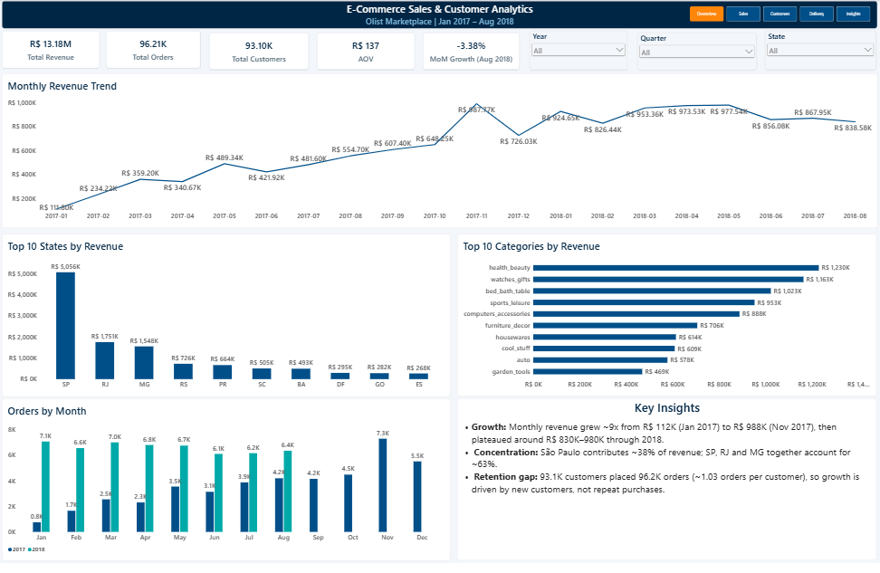
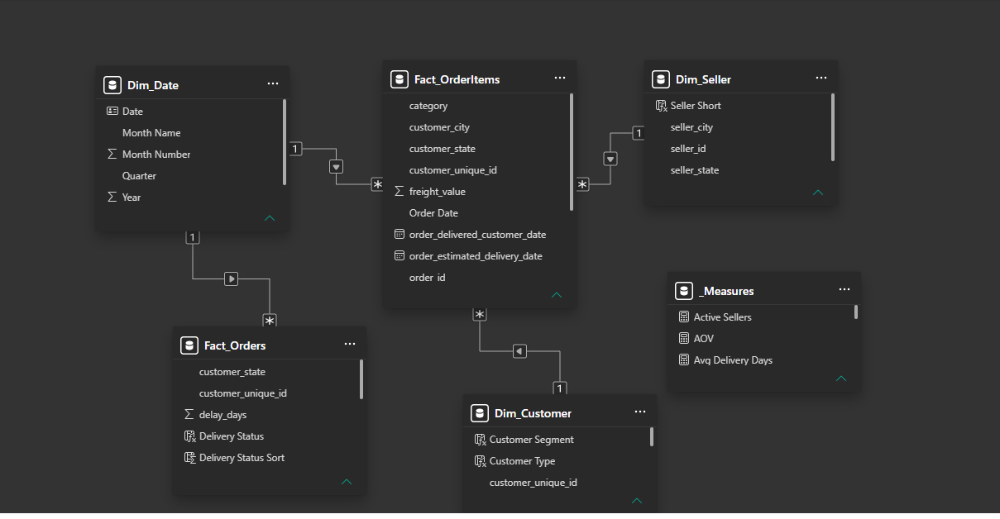
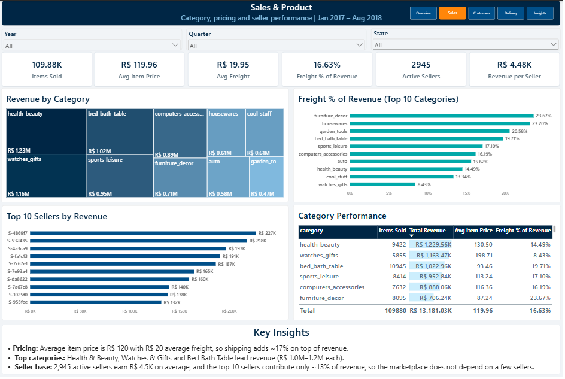
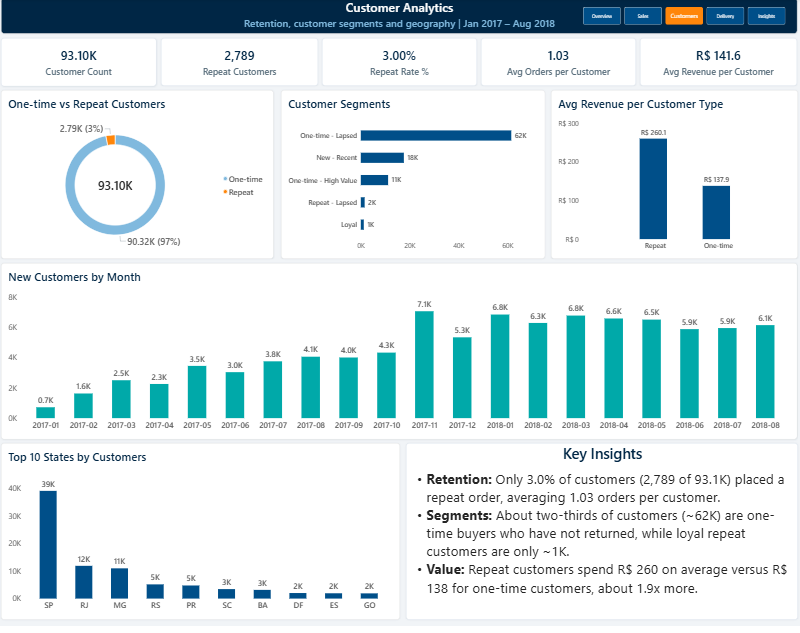
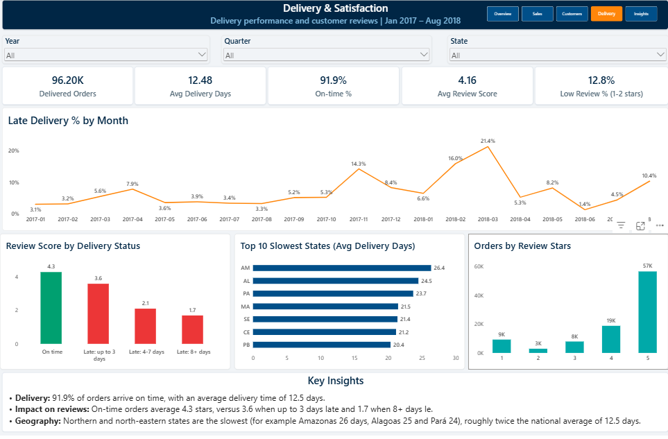
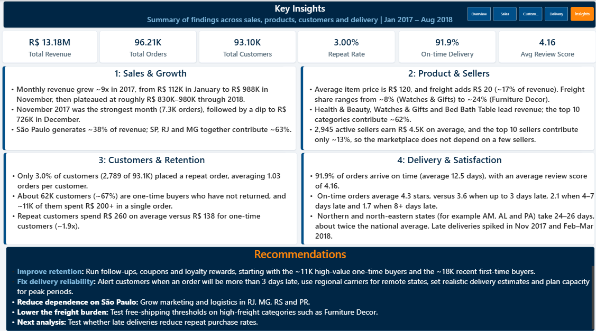

# E-Commerce Sales & Customer Analytics Dashboard

End-to-end analytics project on the **Olist Brazilian e-commerce marketplace**, built with **SQL Server, Excel and Power BI**. The dashboard covers sales performance, products and sellers, customer retention, and delivery performance and satisfaction.




**Quick links:** [Full project report (PDF)](docs/Ecommerce_Analytics_Project_Report.pdf) | [Dashboard export (PDF)](dashboard/Ecommerce_Dashboard.pdf) | [SQL scripts](sql/) | [Excel validation](excel/Ecommerce_Validation.xlsx)

---

## Table of Contents
- [Overview](#overview)
- [Key Metrics](#key-metrics)
- [Dataset](#dataset)
- [Tools and Skills](#tools-and-skills)
- [Project Workflow](#project-workflow)
- [Data Model](#data-model)
- [Dashboard Pages](#dashboard-pages)
- [Key Findings](#key-findings)
- [Recommendations](#recommendations)
- [Data Quality and Validation](#data-quality-and-validation)
- [Repository Structure](#repository-structure)
- [How to Reproduce](#how-to-reproduce)
- [Limitations and Future Work](#limitations-and-future-work)
- [Project Report](#project-report)
- [Acknowledgements](#acknowledgements)
- [Author](#author)

---

## Overview
The goal of this project is to turn raw marketplace data into a decision-ready dashboard for an online business. The raw CSV files were imported into SQL Server, cleaned and shaped into analytical views, modelled as a star schema in Power BI, and presented in a five-page dashboard. The headline numbers were cross-checked across SQL, Excel and Power BI.

**Business questions answered**
- How are revenue and orders trending, and which states and categories drive them?
- Which products sell best, how heavy is freight, and how concentrated is the seller base?
- How many customers come back, and which customer segments are most valuable?
- How reliable is delivery, how does lateness affect reviews, and which regions are slowest?
- What should the business do next?

**Analysis period:** January 2017 to August 2018, delivered orders only, amounts in Brazilian Real (R$).

## Key Metrics

| Metric | Value |
|---|---|
| Total revenue | R$ 13.18M |
| Delivered orders | 96,211 |
| Unique customers | 93,104 |
| Average order value | R$ 137 |
| Repeat customer rate | 3.0% |
| On-time delivery rate | 91.9% |
| Average delivery time | 12.5 days |
| Average review score | 4.16 |

## Dataset
**Source:** [Brazilian E-Commerce Public Dataset by Olist (Kaggle)](https://www.kaggle.com/datasets/olistbr/brazilian-ecommerce)

Eight tables were imported into SQL Server. The raw data is **not included** in this repository (see [data/README.md](data/README.md)).

| Table | Rows | Used for |
|---|---|---|
| olist_customers_dataset | 99,441 | Customers and locations |
| olist_orders_dataset | 99,441 | Order status and timestamps |
| olist_order_items_dataset | 112,650 | Price, freight, product and seller per item |
| olist_products_dataset | 32,951 | Product category |
| olist_sellers_dataset | 3,095 | Seller location |
| olist_order_payments_dataset | 103,886 | Imported, not used in the dashboard |
| olist_order_reviews_dataset | 99,224 | Review scores |
| product_category_name_translation | 71 | English category names |

The geolocation file (about one million rows) was not used, because state and city were sufficient.

## Tools and Skills

| Tool | How it was used |
|---|---|
| **SQL Server (SSMS)** | Import, data types and nullability, data quality fixes, analytical views, validation and analysis queries |
| **Excel** | Cross-validation with formulas (SUMIFS, UNIQUE, FILTER) and pivot summaries |
| **Power BI** | Star-schema model, Power Query, DAX measures, five-page report, theme and navigation |

**Skills demonstrated:** SQL joins, views, CTEs and window functions; data cleaning; star-schema data modelling; DAX (measures, calculated tables and columns, variables, SWITCH); dashboard design and storytelling; data validation across tools.

## Project Workflow
1. **Planning:** chose the dataset, defined business questions, set up the project folders, colour palette and typography.
2. **SQL data engineering:** created the `olist_ecommerce` database, imported eight CSV files, set data types, verified row counts, fixed a header-row issue and built the views `vw_order_items` and `vw_orders`.
3. **Power BI data model:** connected to SQL Server, added a Date table, related the tables as a star schema and created a measures table and a custom theme.
4. **Dashboard build:** built four analysis pages, a customer-level table for retention analysis and an order-level fact table for delivery analysis.
5. **Validation:** reconciled revenue, orders, customers and repeat customers across SQL, Excel and Power BI.
6. **Polish and documentation:** added page navigation, per-page insights, a Key Insights page, a PDF export, this README and a detailed project report.

## Data Model
Star schema with two fact tables, because item-level and order-level data have different grains.



| Table | Description |
|---|---|
| `Fact_OrderItems` | One row per order item: price, freight, category, seller, customer |
| `Fact_Orders` | One row per delivered order: delivery days, late flag, review score |
| `Dim_Date` | Calendar table marked as the date table |
| `Dim_Seller` | Seller location and a short label |
| `Dim_Customer` | Customer-level table (orders, revenue, recency, segment) built with DAX |
| `_Measures` | Container for all DAX measures |

Customers are identified with `customer_unique_id`, because `customer_id` changes with every order.

## Dashboard Pages

### 1. Executive Overview
Revenue, orders, customers, average order value, monthly trend, top states and categories, and orders by month.


### 2. Sales & Product
Category revenue, freight share of revenue, top sellers and a category performance table.



### 3. Customer Analytics
Repeat rate, customer segments, new customers by month and customers by state.



### 4. Delivery & Satisfaction
On-time rate, late delivery trend, review score by delivery status, slowest states and review distribution.



### 5. Key Insights
A one-page summary of findings and recommendations.



## Key Findings
- **Growth, then a plateau:** monthly revenue grew about 9x in 2017 (R$ 112K in January to R$ 988K in November) and then stayed around R$ 830K to R$ 980K per month in 2018.
- **Geographic concentration:** São Paulo contributes about 38% of revenue, and São Paulo, Rio de Janeiro and Minas Gerais together contribute about 63%.
- **Balanced catalogue and seller base:** the top five categories contribute about 40% of revenue, and the top 10 sellers only about 13%.
- **Freight is a meaningful cost:** shipping adds about 17% on top of product revenue, from 8.4% (Watches & Gifts) to 23.7% (Furniture Decor).
- **Weak retention:** only 3.0% of customers (2,789 of 93.1K) placed a repeat order. About two-thirds of customers are one-time buyers who have not returned.
- **Repeat customers are worth more:** they spend R$ 260 on average versus R$ 138 for one-time customers, about 1.9x.
- **Delivery drives satisfaction:** 91.9% of orders arrive on time, but review scores fall from 4.3 stars (on time) to 3.6 (up to 3 days late), 2.1 (4 to 7 days late) and 1.7 (8 or more days late).
- **Late deliveries peak in busy periods:** the late rate reached 14.3% in November 2017, 16.0% in February 2018 and 21.4% in March 2018. The data does not state the cause.
- **Northern and north-eastern states are slowest:** for example Amazonas 26.4 days, Alagoas 24.5 and Pará 23.7, about twice the national average of 12.5 days. States with fewer than 100 orders (RR, AP and AC) are excluded from the dashboard ranking.

## Recommendations
1. **Improve retention:** run follow-ups, coupons and loyalty rewards, starting with the roughly 11K high-value one-time buyers and the roughly 18K recent first-time buyers.
2. **Fix delivery reliability:** alert customers when an order will be more than 3 days late, use regional carriers for remote states and set realistic delivery estimates.
3. **Plan for peak periods:** prepare carrier capacity ahead of November and February to March.
4. **Reduce dependence on São Paulo:** grow marketing and logistics in RJ, MG, RS and PR.
5. **Lower the freight burden:** test free-shipping thresholds on high-freight categories such as Furniture Decor.

## Data Quality and Validation
**Issues found and fixed**
- The category translation file imported its header as a data row (columns named `column1` and `column2`). The columns were renamed and the header row removed, leaving the correct 71 rows.
- Numeric and date columns were widened or made nullable where the import wizard guessed too narrow types.
- Orders with several reviews would create duplicate rows, so the review score is averaged per order in `vw_orders`.
- An automatic relationship between the two fact tables caused ambiguous filter paths and was removed.

**Cross-checks**

| Check | Result |
|---|---|
| Row counts of all imported tables | Matched |
| SQL view total (R$ 13,221,498.11, 96,478 orders) against Power BI before the date filter | Matched |
| Revenue, orders and customers in the analysis window across SQL, Excel and Power BI | Matched |
| Repeat customers: SQL (2,789 of 93,104) against Power BI | Matched |
| SQL analysis queries (state and category shares, customer split, review by delivery status) against the dashboard | Matched |

## Repository Structure
- `dashboard/`: Power BI report (.pbix), PDF export and colour theme
- `sql/`: SQL Server scripts (setup and views, validation, analysis, delivery view)
- `excel/`: Excel workbook used to cross-validate the key numbers
- `screenshots/`: dashboard page screenshots and the data model
- `docs/`: detailed project report (PDF and Word)
- `data/`: dataset source and loading instructions (raw data is not included)

```
Olist-Ecommerce-Analytics-Dashboard/
├── README.md
├── dashboard/
├── sql/
├── excel/
├── screenshots/
├── docs/
└── data/
```

## How to Reproduce
1. Download the dataset from [Kaggle](https://www.kaggle.com/datasets/olistbr/brazilian-ecommerce).
2. In SQL Server, create a database named `olist_ecommerce` and import the eight CSV files with the SSMS Import Flat File wizard, keeping the default table names.
3. Run the scripts in the `sql/` folder in order: `01_setup_and_view.sql`, `02_validation_queries.sql`, `03_analysis_queries.sql` and `04_delivery_view.sql`.
4. Open `dashboard/Ecommerce_Dashboard.pbix` in Power BI Desktop. The file contains the imported data, so it opens without SQL Server. To refresh, point the data source to your own SQL Server instance.

## Limitations and Future Work
**Limitations**
- The customer table is calculated at refresh, so it does not respond to the Year, Quarter and State slicers (Page 3 has no slicers).
- A customer is called lapsed relative to 31 August 2018, the last date in the data.
- Averages for states with few orders are less reliable.
- Only delivered orders are analysed, and amounts are in Brazilian Real.
- The link between late delivery and low reviews is an observed relationship, not proof of cause.

**Future work**
- Test whether late delivery lowers the chance of a second purchase using cohort analysis.
- Analyse payment methods and instalments.
- Add text analysis of review comments.
- Add seller-level delivery performance and a geographic map.
- Publish to the Power BI Service with scheduled refresh.

## Project Report
A detailed report covering the full workflow, SQL and DAX code, validation and findings is available in [docs/Ecommerce_Analytics_Project_Report.pdf](docs/Ecommerce_Analytics_Project_Report.pdf). A Word version is included in the same folder.

## Acknowledgements
Data: [Olist](https://olist.com/), published on Kaggle as the Brazilian E-Commerce Public Dataset. This project is for learning and portfolio purposes.

## Author
**Syed Ubedullah Basha**
[LinkedIn](https://linkedin.com/in/syed-ubedullah-basha) | [GitHub](https://github.com/syed-ubedullah)
